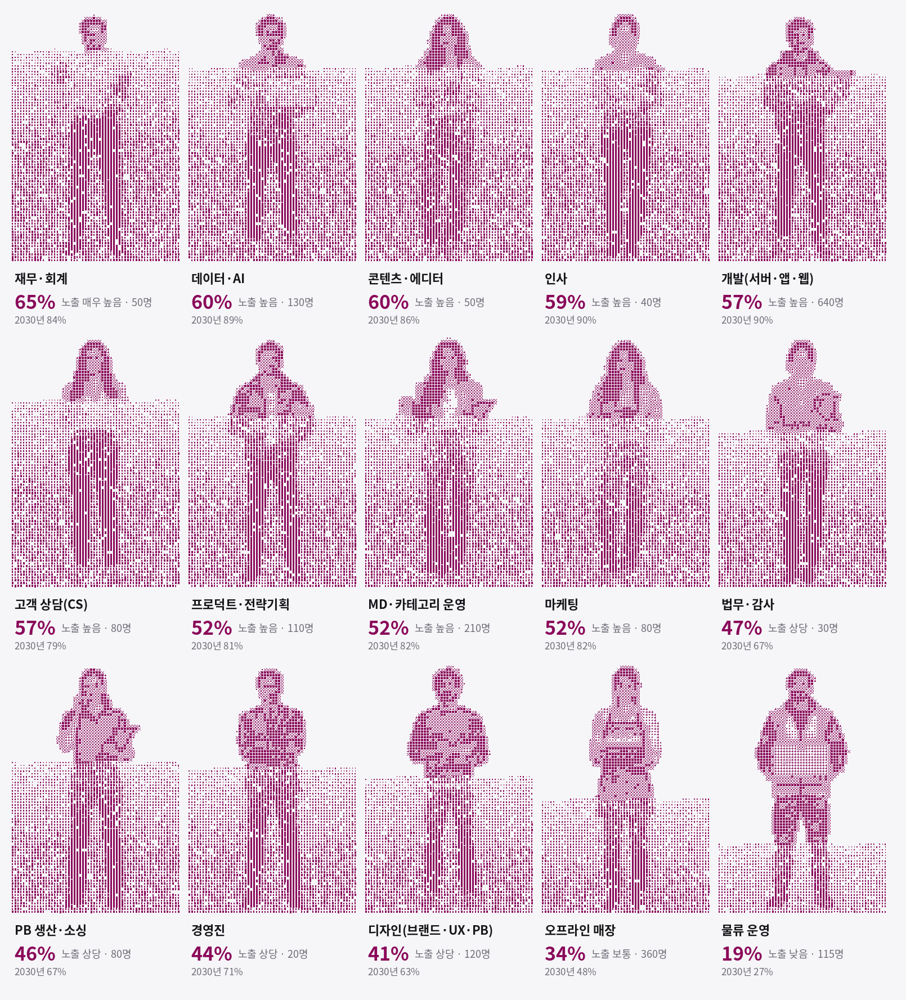
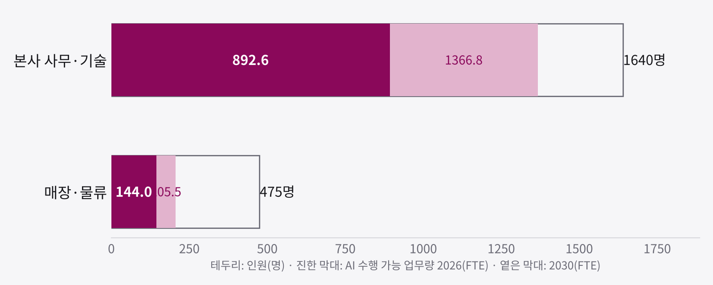
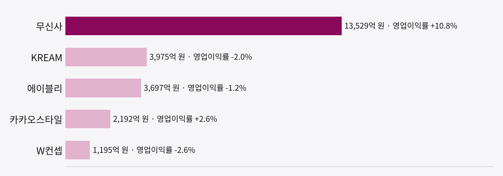
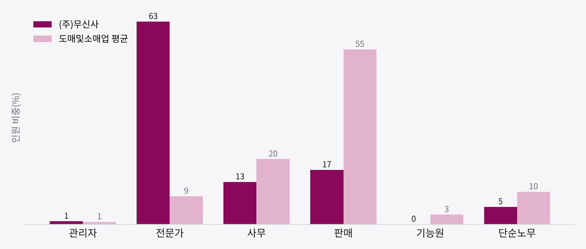
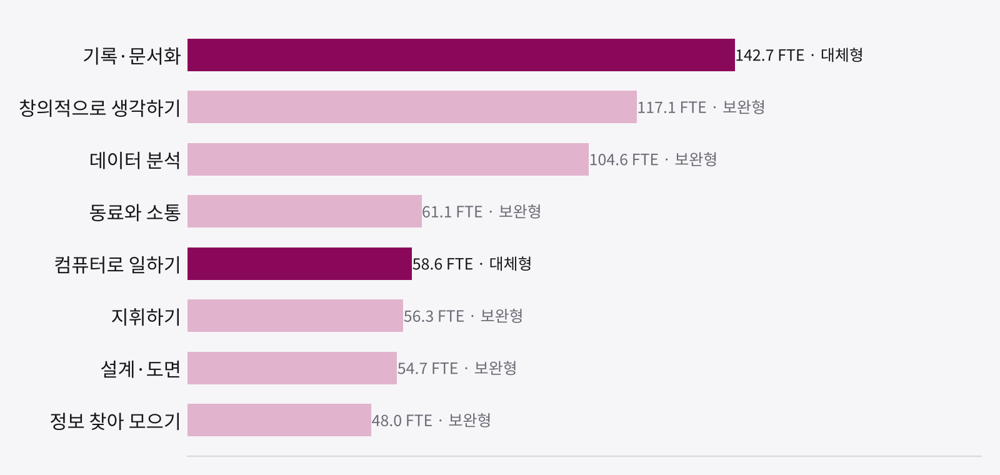

# (주)무신사 AI 직무 노출도 진단 보고서

조직 진단 · 샘플 보고서 · 발행 AI 점령 지도(포스트오피스)

그림 1. 직무별 AI 노출도(2026). 인물별 음영 높이는 해당 직무 업무 중 AI가 수행 가능한 비중이다. 노출 수준: 낮음(20% 미만) · 보통(20~35%) · 상당(35~50%) · 높음(50~65%) · 매우 높음(65% 이상).

**진단 범위** · 대상: (주)무신사 전 직무(2,115명, 15개 직무, 추정 구성) · 기준일: 2026-10-22 · 전망: 2030년 · 대상 독자: 대표이사·CTO 등 경영진, 인사 책임자, 상장 준비 조직

## Executive Summary

<!-- 작성: 핵심 메시지 2~4문장. 근거: 노출도 49.0% vs 도소매업 평균(40%), 보완형 70%, 결론의 축(이 회사에서 AI의 재무적 가치가 나오는 곳) -->

표 1. 핵심 지표

| 지표 | 무신사 | 비교 기준 |
|---|---|---|
| 조직 AI 노출도(2026) | 49.0% (상당) | 도소매업 39.7%, 국내 취업자 31.5% |
| 조직 AI 노출도(2030) | 74.3% (매우 높음) | 도소매업 58.0% |
| AI 수행 가능 업무량 | 1,037 FTE (2030년 1,572 FTE) | 총 2,115명 |
| 해당 업무 인건비 규모 | 연 약 565억 원 | 직종별 평균 임금으로 추정 1,111억 원의 51% |

주: FTE는 AI가 수행 가능한 업무 시간을 정규 인력 수로 환산한 값이다. 인건비 규모는 절감 가능액이 아니라 해당 업무에 투입되는 비용이다.

**주요 발견(수치 초안 — 다듬어 쓸 것)**

1. 본사 사무·기술 1,640명의 노출도는 54%(2030년 83%), 매장·물류 475명은 30%(2030년 43%)다. 전체 1,036.7 FTE 중 892.6 FTE(86%)가 본사 사무·기술에 있다.
2. 단일 직무로는 개발(서버·앱·웹) 640명에 367.3 FTE, 전체의 35%가 있고 그 82%가 보완형이다.
3. 노출 업무의 30%가 대체형이다. 대체형 비중이 높은 직무: 재무·회계(84%), 물류 운영(64%), 법무·감사(57%), 오프라인 매장(51%), 고객 상담(CS)(47%).
4. 단일 업무로는 '기록·문서화'가 142.7 FTE로 가장 크다(대체형).
5. AI 수행 가능 업무의 인건비(연 약 565억 원)는 최근 영업이익(1,405억 원)의 0.4배다.

**의사결정 사항**

<!-- 작성: 경영진이 정할 질문 3개, 각각 해당 인원·FTE를 괄호로 -->

## 1. 회사 현황

<!-- 작성: 한두 문장 요약: 회사의 현재 국면 -->

본 진단의 인원 기준: 국민연금 가입 기준 2,115명(2026.9), 본사 약 1,600명 중 개발 직군 48%(언론 보도)를 바탕으로 한 직무 구성 추정. 매장·물류 인력의 상당 부분은 자회사·외부 위탁일 수 있어 회사 확인이 필요하다..

## 2. 직무별 AI 노출 현황

15개 직무 중 9개가 '높음' 이상, 1개가 '낮음'이다. 가장 높은 직무는 재무·회계(65%), 가장 낮은 직무는 물류 운영(19%)이다. <!-- 작성: 직무 간 차이의 해석 한 문장 -->

표 5. 직무별 AI 노출도와 주요 노출 업무

| 직무 | 인원 | 2026 | 2030 | 노출 수준 | 대체형 비중 | 주요 노출 업무 |
|---|---|---|---|---|---|---|
| 재무·회계 | 50 | 65% | 84% | 매우 높음 | 84% | 기록·문서화, 정보 처리 |
| 데이터·AI | 130 | 60% | 89% | 높음 | 31% | 창의적 사고, 데이터 분석 |
| 콘텐츠·에디터 | 50 | 60% | 86% | 높음 | 36% | 기록·문서화, 문제 해결 |
| 인사 | 40 | 59% | 90% | 높음 | 36% | 채용·배치, 정보 수집 |
| 개발(서버·앱·웹) | 640 | 57% | 90% | 높음 | 18% | 데이터 분석, 창의적 사고 |
| 고객 상담(CS) | 80 | 57% | 79% | 높음 | 47% | 기록·문서화, 대외 응대 |
| 프로덕트·전략기획 | 110 | 52% | 81% | 높음 | 26% | 기록·문서화, 데이터 분석 |
| MD·카테고리 운영 | 210 | 52% | 82% | 높음 | 16% | 데이터 분석, 창의적 사고 |
| 마케팅 | 80 | 52% | 82% | 높음 | 16% | 데이터 분석, 창의적 사고 |
| 법무·감사 | 30 | 47% | 67% | 상당 | 57% | 기록·문서화, 정보 수집 |
| PB 생산·소싱 | 80 | 46% | 67% | 상당 | 43% | 기록·문서화, 데이터 분석 |
| 경영진 | 20 | 44% | 71% | 상당 | 22% | 지휘·조율, 기록·문서화 |
| 디자인(브랜드·UX·PB) | 120 | 41% | 63% | 상당 | 12% | 창의적 사고, 협업·소통 |
| 오프라인 매장 | 360 | 34% | 48% | 보통 | 51% | 기록·문서화, 행정 처리 |
| 물류 운영 | 115 | 19% | 27% | 낮음 | 64% | 기록·문서화, 정보 처리 |

주: 인원은 추정치. 대체형 비중은 노출 업무 중 AI가 독자적으로 완결하기 쉬운 업무(문서화·정보 처리·행정 등)의 비중. MD·카테고리 운영과 마케팅는 대응 직업 분류가 같아 같은 값으로 산출됨.

그림 2. 직무군별 인원과 AI 수행 가능 업무량. 본사 사무·기술 892.6 FTE(2030년 1,366.8 FTE), 매장·물류 144.0 FTE(2030년 205.5 FTE).

**해석.** <!-- 작성: 대체형 비중이 높은 직무, 2030년에 크게 오르는 직무의 의미 -->

## 3. 동종업계·업종 비교

<!-- 작성: 동종사 대비 이 회사의 위치 한두 문장 -->

표 6. 동종·유관 기업 비교(단위: 억 원)

| 기업 | 사업 | 매출 | 영업이익률 | 인원 | AI 동향 |
|---|---|---|---|---|---|
| 무신사 | – | 13,529 | 10.8% | 2,115 | 확인 안 됨 |
| 에이블리 | – | 3,697 | −1.2% | 388 | 확인 안 됨 |
| KREAM | – | 3,975 | −2.0% | 235 | 확인 안 됨 |
| W컨셉 | – | 1,195 | −2.6% | 226 | 확인 안 됨 |
| 카카오스타일 | – | 2,192 | 2.6% | 451 | 확인 안 됨 |

출처: 각 사 감사보고서·사업보고서. 인원과 매출의 시점·기준이 달라 1인당 매출은 계산하지 않았다.

그림 3. 매출 규모와 영업이익률. 무신사의 매출은 13,529억 원(나머지 4개사 합계 11,059억 원), 영업이익률은 5개사 중 1위다.

**업종 평균과의 비교.** 도소매업 취업자의 직업 구성으로 계산한 업종 평균 노출도는 39.7%(2030년 58.0%)로, 무신사(49.0%, 2030년 74.3%)보다 낮다. 구성 차이가 가장 큰 대분류는 전문가 63%(업종 9%), 판매 17%(업종 55%)이다. <!-- 작성: 구성 차이가 노출도 차이를 어떻게 설명하는지 -->

그림 4. 직업 구성 비교(인원 비중, %). 업종 평균은 국가데이터처 지역별고용조사 2025년 하반기.

**시사점**

<!-- 작성: 동종사 동향에서 나오는 시사점 3개 -->

## 4. 경영 시사점

<!-- 작성: 이 회사에서 AI의 재무적 가치가 어디서 나오는지 한 단락 --> (근거: 인건비 규모 565억 원, 영업이익 1,405억 원)

그림 5. 업무별 AI 수행 가능 업무량(인원 가중, FTE). 진한 막대는 대체형, 옅은 막대는 보완형. 기록·문서화 142.7 FTE, 창의적 사고 117.1 FTE, 데이터 분석 104.6 FTE 순.

<!-- 작성: 4.1~4.5 소제목+본문. 레버 후보(FTE 순): 개발(서버·앱·웹) 640명 367.3 FTE(대체형 18%), 오프라인 매장 360명 121.9 FTE(대체형 51%), MD·카테고리 운영 210명 108.7 FTE(대체형 16%) -->

**유의 사항.** 본 수치는 직업 단위 경향이며 직무별 인원이 추정치이므로, 인원 감축 의사결정의 근거로 사용하지 않는다.

## 5. 인적자원 시사점

<!-- 작성: 인사 과제의 성격 한 단락(감원이 아닌 무엇) -->

**5.1 직무 재설계 대상**

표 7. 재설계 우선 직무와 전환 방향

| 직무 | 현황 | 전환 방향 | 근거 |
|---|---|---|---|
| 재무·회계(50명) | 노출 65%, 대체형 84% | <!-- 작성: 방향 --> | <!-- 작성: 근거 --> |
| 법무·감사(30명) | 노출 47%, 대체형 57% | <!-- 작성: 방향 --> | <!-- 작성: 근거 --> |
| 고객 상담(CS)(80명) | 노출 57%, 대체형 47% | <!-- 작성: 방향 --> | <!-- 작성: 근거 --> |
| 콘텐츠·에디터(50명) | 노출 60%, 대체형 36% | <!-- 작성: 방향 --> | <!-- 작성: 근거 --> |

<!-- 작성: 5.2~5.4 주니어 육성·유지·평가 등 회사 사정에 맞는 항목 -->

**5.5 노사·법적 환경: 한국과 미국**

표 8. AI 도입 관련 노사·법적 요건 비교

| 항목 | 한국(무신사 적용) | 미국(참고) |
|---|---|---|
| 노사협의회 | 상시 30명 이상 사업장 설치 의무(근로자참여법 제4조). 신기계·기술 도입, 기술상 사정에 따른 배치전환·재훈련, 근로자 감시 설비가 협의 사항(제20조) | 해당 제도 없음 |
| 노동조합 | 조합 유무 확인 필요. 직종별 가입률: 전문가 9.1%, 판매 4.8%, 사무 11.1%, 단순노무 4.5%(2025). 조합이 있는 경우 AI 도입에 따른 직무·인력 변경 계획은 교섭 대상(고용노동부 지침, 2026.9) | 가입률 컴퓨터·수학직 3.7%, 판매직 2.5%, 경영·재무직 4.7%(2025) |
| 해고 규제 | 정당한 이유 필요, 경영상 해고 시 50일 전 협의(근로기준법 제23·24조). OECD 고용보호지표 2.37 | 임의고용 원칙. 0.75 |
| AI 규율 | 채용 단계 AI 활용은 AI 기본법 고영향 영역. AI 단독 결정에 의한 해고·감봉 금지 근로기준법 개정안 발의(2026.6) | 연방법 없음, 주·도시별 규율 |

AI 도입 계획을 노사협의회에 사전 상정하는 것은 법적 요건이자, 구성원 불안을 낮추는 가장 비용 효율적인 방법이다.

## 6. 90일 실행 로드맵

<!-- 작성: 시범 범위 한 문장 -->

표 9. 단계별 실행 과제

| 시기 | 경영진 | 인사(HR) |
|---|---|---|
| 0~30일 | <!-- 작성: 기준선 측정·시범 선정 --> | 노사협의회에 AI 활용 계획 상정(인력 감축 목적 아님 명시). 실제 인원표 기준 재진단. 퇴사 사유 분석 |
| 31~60일 | <!-- 작성: 시범 운영 --> | <!-- 작성: 교육·직무 재설계 협의 --> |
| 61~90일 | <!-- 작성: 평가 후 확대 결정 --> | <!-- 작성: 육성·평가 체계 확정 --> |

성과 지표(KPI): <!-- 작성: 5~7개 -->

## 부록. 방법론과 한계

재무·인력 현황은 공개 자료로 교차 확인했고, 직무 구성은 공개 정보에 기반한 추정치다. 실제 인원표를 받으면 같은 방법으로 다시 산출한다.

- **인원**: 국민연금 가입 기준 2,115명(2026.9), 본사 약 1,600명 중 개발 직군 48%(언론 보도)를 바탕으로 한 직무 구성 추정. 매장·물류 인력의 상당 부분은 자회사·외부 위탁일 수 있어 회사 확인이 필요하다..
- **AI 노출도**: 직무별로 한국표준직업분류 소분류를 연결하고, 해당 직업의 41개 업무 활동 구성에 업무별 AI 수행 가능성을 곱해 산출. 업무 단위 수행 가능성은 Eloundou 외(2024, Science)와 국제노동기구 Gmyrek 외(2025)의 평균이며, 기준일 시점의 주간 AI 동향 보정을 반영.
- **대체형·보완형**: 41개 업무 중 문서화·정보 처리·행정 처리 등 11개를 대체형으로 분류.
- **FTE·인건비**: 인원 × 노출도로 FTE를 산출하고, 직종 대분류별 월 임금총액(고용형태별근로실태조사 2025)을 곱해 추정.
- **업종 평균**: 도소매업 취업자의 직업 대분류 구성(지역별고용조사 2025년 하반기) × 대분류별 전국 평균 노출도. 대분류 안의 구성 차이는 반영하지 못한 근사치.
- **한계**: 업무 활동 구성은 미국 직업 기준(O*NET 31.0)이며 당사 실제 업무와 차이가 있을 수 있음. MD·카테고리 운영과 마케팅는 같은 직업 분류로 계산됨.

**확인 요청 사항**

- 직무별 실제 인원(정규·계약·외부 인력 구분)과 급여 총액
- 노동조합 유무 및 노사협의회 운영 현황
- 현재 사용 중인 AI·자동화 도구

**출처**

- 지역별고용조사 산업/직업별 취업자(KOSIS DT_1ES3B33J) · 직종별 임금(DT_118N_LCE306) · 직종별 노조가입률(DT_118N_LCE310)
- 근로자참여 및 협력증진에 관한 법률 · 근로기준법 · 미국 노동통계국 노조 가입률 2025 · OECD 고용보호법제 지표 · [AI 점령 지도](https://aijido.org)
